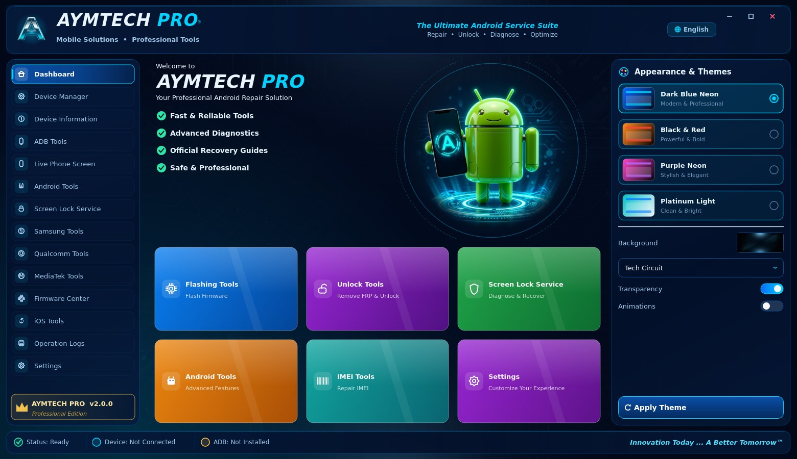

# AYMTECH PRO 2.0

A Windows desktop toolkit for mobile repair technicians, built with PySide6.
Version 2.0 introduces a completely rebuilt interface in a "holographic tech"
style: glowing glass panels, four colour themes, custom painted widgets and a
fully translated English / French / Arabic UI with right-to-left support.



## Run
```bat
py -m pip install -r requirements.txt
py main.py
```

## Build the Windows executable
```bat
build_windows.bat
```
The bundled application is written to `dist\AYMTECH_PRO\AYMTECH_PRO.exe`.

## Interface
- **Header** – brand emblem, product wordmark, tagline, language menu and
  window controls. The window is frameless: drag it by the header, resize it
  from any edge, double-click the header to maximise.
- **Sidebar** – 14 service pages with vector icons, an active pill highlight,
  its own scroll area for short screens, and a gold version plate.
- **Dashboard** – welcome block with the feature checklist, the mascot on a
  holographic ring, and six gradient action cards that reflow between 1, 2 and
  3 columns.
- **Appearance panel** – live theme previews, background selector,
  transparency and animation switches, and an *Apply Theme* button.
- **Status bar** – service state, connected device, ADB availability and a
  running clock.

## Themes
| Theme | Palette |
| --- | --- |
| Dark Blue Neon | `#00d3ff` on `#020a1e` |
| Black & Red | `#ff4436` on `#0b0304` |
| Purple Neon | `#bb6bff` on `#08040f` |
| Platinum Light | `#0a7bff` on `#eef2f8` |

Every surface – panels, cards, buttons, tables, inputs, scrollbars, tooltips –
is generated from a single `Palette` object in `ui/theme.py`, so switching a
theme recolours the whole application instantly. Theme, language, background,
transparency and animation preferences persist through `QSettings`.

## Features
- ADB device detection, device manager and device information.
- ADB tools: reboot modes, APK install, screenshots, app list, battery and
  storage reports, plus a live phone screen preview.
- Android diagnostics: full report, battery health, storage analysis, apps.
- Samsung / Qualcomm / MediaTek tool pages and a firmware centre with file
  inspection and SHA-256 verification.
- Screen lock service: device detection, security diagnostics, lock
  information and official recovery guidance.
- Operation log with timestamps.

## Project layout
```
main.py              # main window, pages and app wiring
ui/theme.py          # palettes and stylesheet generation
ui/widgets.py        # painted widgets (panels, nav buttons, cards, switches)
ui/shell.py          # header, sidebar, theme dock, footer
ui/dashboard.py      # dashboard view
ui/pages.py          # page wrapper
ui/icons.py          # QPainter vector icon set
assets/              # logo, mascot and background artwork
tools/               # ADB/tool logic and translations
```

## Screenshots
Generate fresh captures without opening a window:
```bat
py main.py --export-screenshots
```
Images are written to `screenshots/`.

## Scope and limits
This is not a full flashing suite. It does not write firmware, unlock
bootloaders or remove device security. Firmware availability depends on the
model and region, and compatibility, signatures and file sources must be
verified before any operation. iPhone recovery is performed with Apple Devices
or official Apple tools and may erase data.

## Official sources
- Android SDK Platform-Tools: https://developer.android.com/tools/releases/platform-tools
- Apple Restore Help: https://support.apple.com/en-us/118106
- Samsung Support: https://www.samsung.com/support/
- Xiaomi Support: https://www.mi.com/global/support/
- Google Pixel Help: https://support.google.com/pixelphone/
