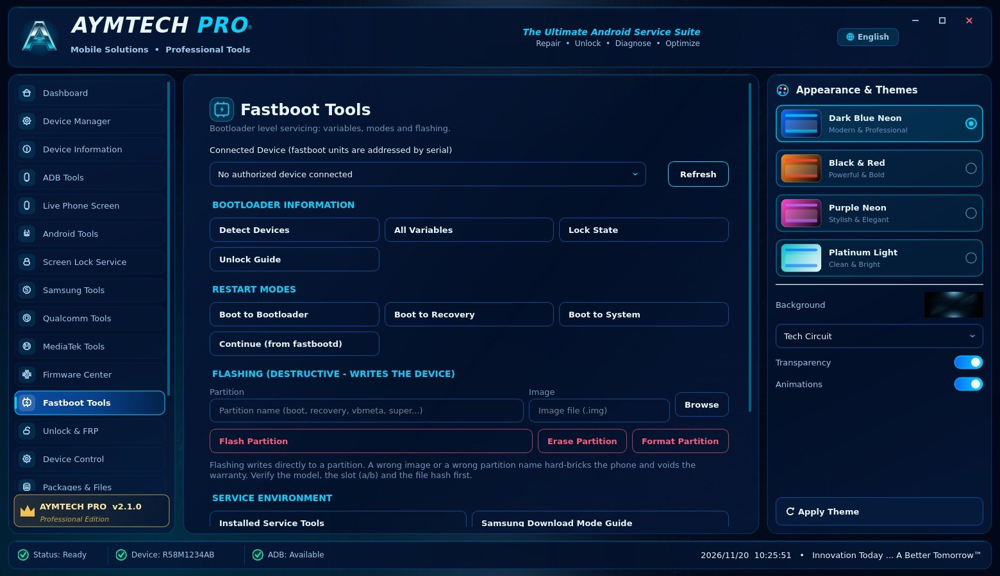
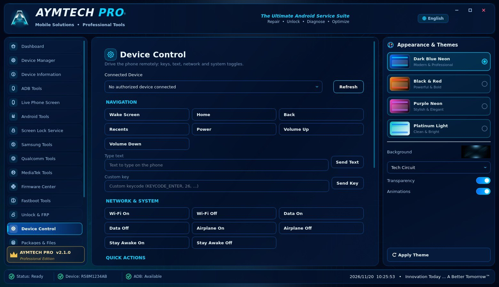
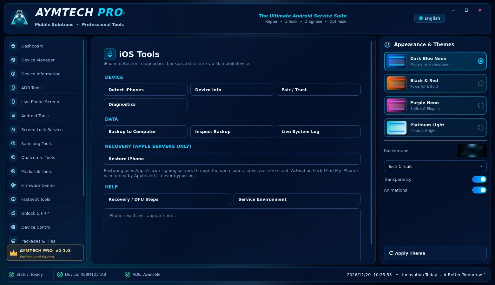

# AYMTECH PRO 2.1

A Windows desktop toolkit for mobile repair technicians, built with PySide6.
Version 2.0 introduces a completely rebuilt interface in a "holographic tech"
style: glowing glass panels, four colour themes, custom painted widgets and a
fully translated English / French / Arabic UI with right-to-left support.


| Fastboot Tools | Unlock & FRP |
| --- | --- |
|  |  |

| Device Control | iOS Tools |
| --- | --- |
|  |  |

## Run
```bat
py -m pip install -r requirements.txt
py main.py
```

## Build the Windows executable
```bat
build_windows.bat
```
The bundled application is written to `dist\AYMTECH_PRO\AYMTECH_PRO.exe`.

## Interface
- **Header** – brand emblem, product wordmark, tagline, language menu and
  window controls. The window is frameless: drag it by the header, resize it
  from any edge, double-click the header to maximise.
- **Sidebar** – 14 service pages with vector icons, an active pill highlight,
  its own scroll area for short screens, and a gold version plate.
- **Dashboard** – welcome block with the feature checklist, the mascot on a
  holographic ring, and six gradient action cards that reflow between 1, 2 and
  3 columns.
- **Appearance panel** – live theme previews, background selector,
  transparency and animation switches, and an *Apply Theme* button.
- **Status bar** – service state, connected device, ADB availability and a
  running clock.

## Themes
| Theme | Palette |
| --- | --- |
| Dark Blue Neon | `#00d3ff` on `#020a1e` |
| Black & Red | `#ff4436` on `#0b0304` |
| Purple Neon | `#bb6bff` on `#08040f` |
| Platinum Light | `#0a7bff` on `#eef2f8` |

Every surface – panels, cards, buttons, tables, inputs, scrollbars, tooltips –
is generated from a single `Palette` object in `ui/theme.py`, so switching a
theme recolours the whole application instantly. Theme, language, background,
transparency and animation preferences persist through `QSettings`.

## New in 2.1 – service suite
- **Fastboot Tools** – device detection, full `getvar` parsing, bootloader lock
  state, restart modes, and partition **flash / erase / format** behind a
  typed confirmation.
- **Unlock & FRP** – an honest lock report (bootloader, verified boot, Knox
  warranty bit, FRP, signed-in accounts, device admins/MDM), the only two lock
  operations Android actually supports, and the official removal paths.
- **Device Control** – key events, text input, Wi-Fi / data / airplane toggles,
  stay-awake, animation scale, settings shortcuts and wireless ADB pairing.
- **Packages & Files** – user/system package lists, app info, install,
  uninstall, disable, clear data, plus browse, pull, push and delete.
- **Logs & Reports** – logcat, battery, keyguard and a full security report that
  can be saved as a text file.
- **iOS Tools** – iPhone detection, diagnostics, pairing, backup, live syslog
  and restore via `libimobiledevice` (Apple servers only, no Activation Lock
  bypass).
- Every new page runs its commands on the worker pool with the same spinner
  and busy overlay, and is fully translated (EN / FR / AR, RTL included).

## Features
- ADB device detection, device manager and device information.
- ADB tools: reboot modes, APK install, screenshots, app list, battery and
  storage reports, plus a live phone screen preview.
- Android diagnostics: full report, battery health, storage analysis, apps.
- Samsung / Qualcomm / MediaTek tool pages and a firmware centre with file
  inspection and SHA-256 verification.
- Screen lock service: device detection, security diagnostics, lock
  information and official recovery guidance.
- Operation log with timestamps.
- Every ADB read runs on a worker thread: the window never freezes, a spinner
  shows on the device row, and long operations dim the page with a
  *Working, please wait...* overlay.
- One shared device registry polls `adb devices -l`, so a phone plugged in
  after start-up appears on every page (and the status bar) within seconds.

## Project layout
```
main.py              # main window, pages and app wiring
ui/theme.py          # palettes and stylesheet generation
ui/widgets.py        # painted widgets (panels, nav buttons, cards, switches)
ui/shell.py          # header, sidebar, theme dock, footer
ui/dashboard.py      # dashboard view
ui/pages.py          # page wrapper
ui/icons.py          # QPainter vector icon set
ui/tools_ui.py       # shared builder for the service pages
ui/tasks.py          # QThreadPool runner for background ADB work
ui/devices.py        # shared device registry + combo-box binding
ui/busy.py           # inline spinner and page busy overlay
assets/              # logo, mascot and background artwork
tools/adb_tools.py   # ADB engine
tools/fastboot_tools.py  # bootloader operations
tools/device_control.py  # keys, text, packages, files, logcat
tools/diagnostics.py     # security / battery / lock reports
tools/unlock_tools.py    # lock & FRP analysis, vendor guidance
tools/ios_tools.py       # libimobiledevice wrapper
tools/proc.py            # shared subprocess helper
```

## Screenshots
Generate fresh captures without opening a window:
```bat
py main.py --export-screenshots
```
Images are written to `screenshots/`.

## Scope and limits
The suite performs real ADB and Fastboot operations, but it is **not** a
lock-bypass product:

- Flashing writes whatever image you select to whatever partition you name.
  Model, region, slot and file hash must be verified first — a wrong file
  bricks the phone.
- A bootloader unlock only works when the manufacturer allows it (Pixel,
  Nothing, many Motorola, Xiaomi after the waiting period…). Samsung, Huawei,
  most Oppo/Realme/vivo and carrier units cannot be unlocked at all.
- FRP is cleared by the original account, by the manufacturer/Google after a
  proof of purchase, or by a signed service firmware — never by an ADB command.
  Any tool that claims otherwise is a scam or damages the phone.
- iPhone restore goes through Apple's signing servers; Activation Lock is
  enforced by Apple and is not bypassed.
- Vendor binaries (Odin, Heimdall, EDL, SP Flash, libimobiledevice) are not
  bundled; the app detects what is installed and explains what is missing.

## Official sources
- Android SDK Platform-Tools: https://developer.android.com/tools/releases/platform-tools
- Apple Restore Help: https://support.apple.com/en-us/118106
- Samsung Support: https://www.samsung.com/support/
- Xiaomi Support: https://www.mi.com/global/support/
- Google Pixel Help: https://support.google.com/pixelphone/
