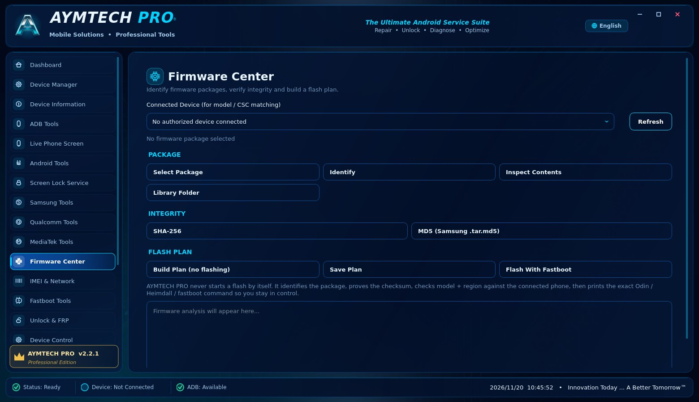
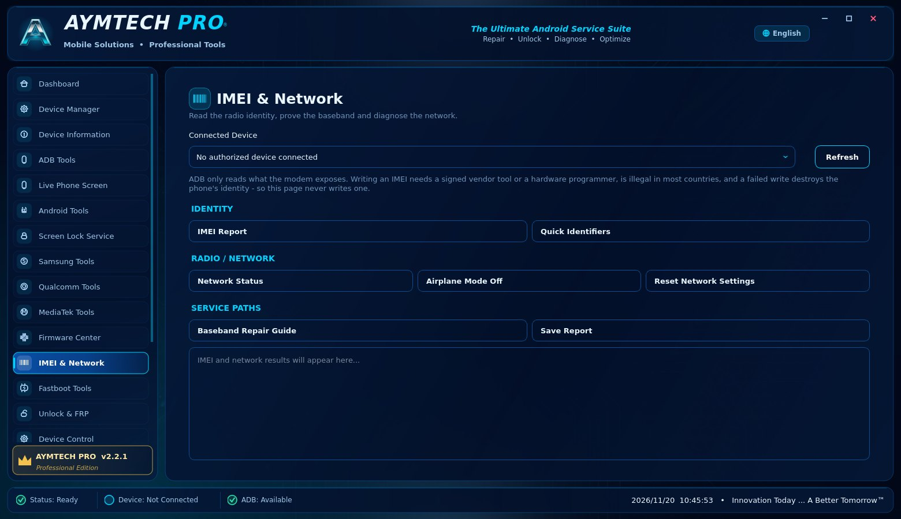
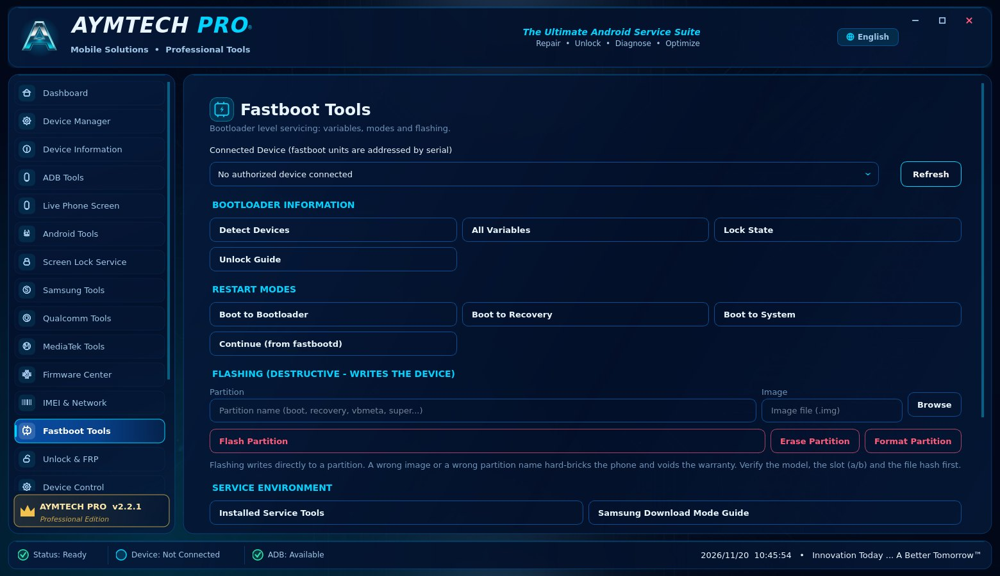
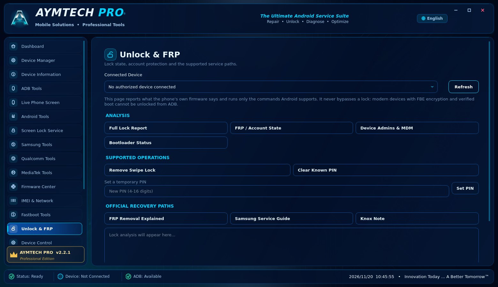
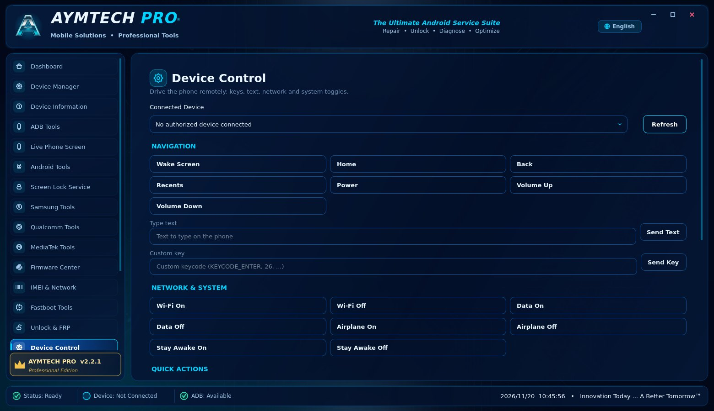
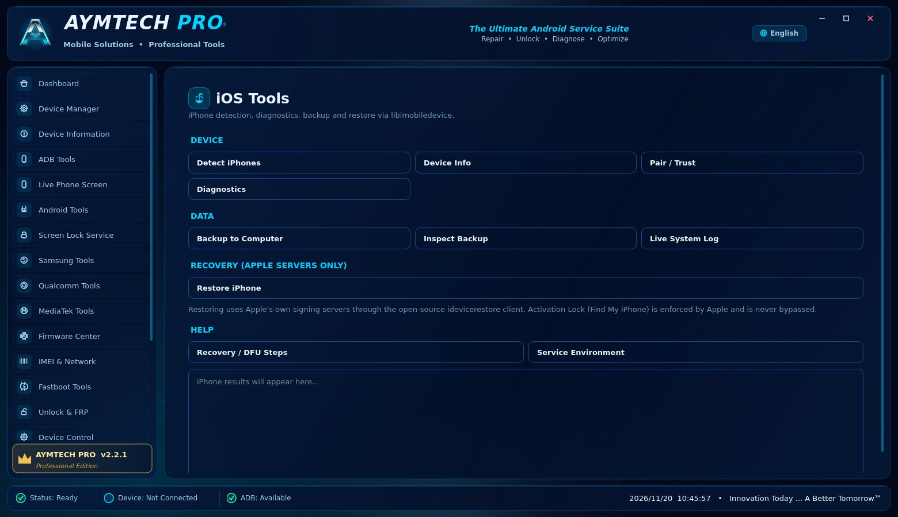
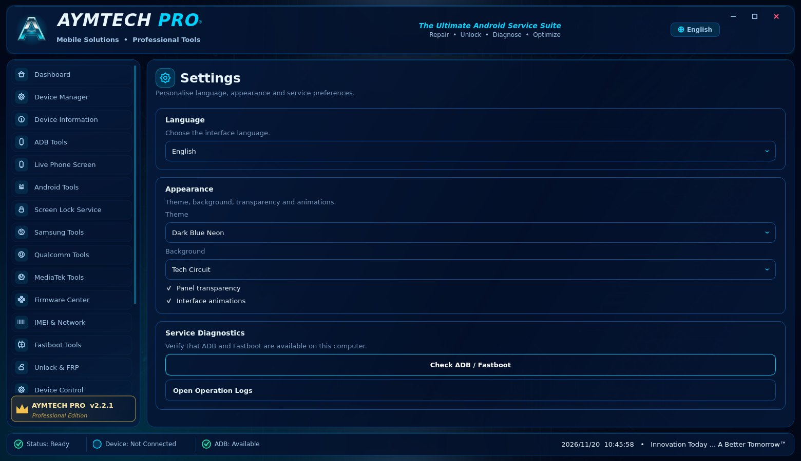

# AYMTECH PRO — النسخة 2.2.1

برنامج Windows لصيانة الهواتف يعتمد على واجهة رسومية حديثة (PySide6) بأسلوب
"Holographic Tech": نوافذ زجاجية مضيئة، أربع سمات ألوان، خلفيات تقنية، وواجهة
عربية/فرنسية/إنجليزية كاملة مع دعم الاتجاه من اليمين إلى اليسار.


| مركز ملفات النظام | IMEI والشبكة |
| --- | --- |
|  |  |

| أدوات Fastboot | فتح الأقفال و FRP |
| --- | --- |
|  |  |

| التحكم بالجهاز | أدوات iOS |
| --- | --- |
|  |  |

| الإعدادات ← المظهر |
| --- |
|  |

## التشغيل
1. ثبّت Python 3.10 أو أحدث.
2. افتح مجلد المشروع في Terminal.
3. نفّذ:
   ```bat
   py -m pip install -r requirements.txt
   py main.py
   ```

## إنشاء نسخة EXE
شغّل `build_windows.bat`. بعد اكتمال البناء ستجد البرنامج داخل:
`dist\AYMTECH_PRO\AYMTECH_PRO.exe`

## الواجهة الجديدة
- **الشريط العلوي:** شعار AYMTECH PRO، عنوان "The Ultimate Android Service Suite"،
  منتقي اللغة، وأزرار النافذة (تصغير/تكبير/إغلاق) — نافذة بلا إطار مع إمكانية
  تحجيمها من الحواف وسحبها من الشريط العلوي.
- **القائمة الجانبية:** 20 صفحة مع أيقونات متجهة، تمييز الصفحة النشطة، وشريط تمرير
  عند صغر النافذة، وبطاقة الإصدار في الأسفل.
- **الشاشة الرئيسية:** ترحيب مع قائمة الميزات، صورة الماسكوت في هالة دائرية، وشبكة
  6 بطاقات ملوّنة (تفليش، فتح قفل، قفل الشاشة، أدوات Android، IMEI، الإعدادات)
  تتكيّف تلقائيًا بين 1 و2 و3 أعمدة.
- **الإعدادات ← المظهر:** اختيار السمة (Dark Blue Neon، Black & Red، Purple
  Neon، Platinum Light)، الخلفية (Tech Circuit / Deep Space / Classic Grid)،
  الشفافية، والحركات. لوحة السمات الجانبية القديمة مخفية الآن (يمكن إرجاعها
  بجعل `SHOW_THEME_PANEL = True` في `main.py`)، فتأخذ صفحات الأدوات عرض النافذة
  كاملًا.
- **شريط الحالة:** الحالة، الجهاز المتصل، توفّر ADB، الساعة والشعار.

## السمات والخلفيات
كل العناصر (اللوحات، البطاقات، الأزرار، الجداول، حقول الإدخال، أشرطة التمرير)
مبنية على لوحة ألوان واحدة في `ui/theme.py`، لذا يؤدي تغيير السمة إلى إعادة تلوين
البرنامج بالكامل فورًا. تُحفظ السمة واللغة والخلفية والشفافية والحركات في
`QSettings` وتُستعاد عند التشغيل التالي.

## الجديد في 2.2.1 — مساحة عمل أنظف
- **إخفاء لوحة السمات الجانبية** لتأخذ صفحات الأدوات عرض النافذة كاملًا. انتقلت
  خيارات السمة والخلفية والشفافية والحركات إلى **الإعدادات ← المظهر**، وأسماء
  السمات كلها مترجمة (عربي / فرنسي / إنجليزي).
- تغيير السمة أو اللغة أو ساعة التذييل لم تعد تتعارض مع بعضها: صناديق الاختيار
  أصبحت داخل منظومة الترجمة، وشعار التذييل يُترجم مع كل تحديث للساعة.

## الجديد في 2.2 — مركز التفليش وهوية الراديو
- **مركز ملفات النظام أُعيد بناؤه** كمركز تفليش: يتعرّف على الشركة والطراز
  والمنطقة (CSC) والإصدار من اسم الحزمة، يعرض أقسام ملف ZIP أو `.tar.md5`، يحسب
  SHA-256 و MD5، يقارن الطراز والمنطقة مع **الهاتف الموصول**، ثم يطبع أمر
  Odin / Heimdall / fastboot / SP Flash / idevicerestore المناسب. **لا يبدأ
  التفليش تلقائيًا أبدًا.**
- **صفحة IMEI والشبكة:** تقرأ كل خصائص الهوية، تتحقق من IMEI بخوارزمية Luhn،
  تكشف الهوية الصفرية (NV ممسوح) أو المنسوخة، تثبت هل البيزباند يعمل، وتُنتج
  تقريرًا يصلح للشركة/مركز الصيانة مع مسار الإصلاح الصادق لكل حالة. لا كتابة
  لـ IMEI — فهي تحتاج أداة موقّعة أو مبرمجًا عتاديًا وهي مخالفة قانونية في معظم
  الدول.

## الجديد في 2.1 — حزمة الصيانة الاحترافية
- **أدوات Fastboot:** كشف الأجهزة، قراءة كل المتغيرات، حالة قفل البوتلودر، أوضاع
  إعادة التشغيل، وتفليش/مسح/تهيئة الأقسام مع تأكيد كتابي قبل أي عملية خطرة.
- **فتح الأقفال و FRP:** تقرير صادق لحالة القفل (البوتلودر، Verified Boot،
  Knox، FRP، الحسابات المسجّلة، مديرو الجهاز و MDM)، والعمليتان الوحيدتان التي
  يدعمهما Android فعليًا، وطرق الإزالة الرسمية.
- **التحكم بالجهاز:** أزرار الهاتف، إدخال نص، Wi-Fi/البيانات/وضع الطيران،
  إبقاء الشاشة يقظة، سرعة الحركات، فتح الإعدادات، والاقتران اللاسلكي.
- **التطبيقات والملفات:** قوائم التطبيقات، معلومات الحزمة، تثبيت/حذف/تعطيل/مسح
  بيانات، تصفح الملفات وسحبها وإرسالها وحذفها.
- **السجلات والتقارير:** logcat، تقرير البطارية، تقرير القفل، وتقرير أمان شامل
  قابل للحفظ كملف نصي.
- **أدوات iOS:** كشف الآيفون، التشخيص، الاقتران، النسخ الاحتياطي، السجل المباشر،
  والاستعادة عبر `libimobiledevice` (خوادم Apple فقط، دون تجاوز Activation Lock).
- كل صفحة جديدة تعمل في مسار خلفي مع مؤشر انشغال، ومترجمة بالكامل (عربي/فرنسي/
  إنجليزي مع دعم RTL).

## الوظائف الحالية
- اكتشاف الأجهزة عبر ADB، وإدارة الأجهزة، ومعلومات الجهاز.
- أدوات ADB: إعادة التشغيل، تركيب APK، لقطة شاشة، التطبيقات المثبّتة، البطارية،
  التخزين، وعرض شاشة الهاتف المباشرة.
- تشخيص Android: فحص شامل، صحة البطارية، تحليل التخزين، التطبيقات.
- أدوات Samsung / Qualcomm / MediaTek ومركز ملفات النظام (فحص الملفات و SHA-256).
- خدمة قفل الشاشة: اكتشاف الجهاز، تشخيص الأمان، معلومات القفل، وإرشادات الاسترداد
  الرسمية.
- سجل العمليات مع طوابع زمنية.
- تنفيذ أوامر ADB في مسار خلفي (Thread Pool): الواجهة لا تتجمّد، وتظهر مؤشرات
  دوران صغيرة بجانب اختيار الجهاز، كما تُعرض طبقة خفيفة بعبارة
  «جارٍ العمل، يرجى الانتظار...» عند العمليات الطويلة.
- سجل أجهزة مركزي واحد يقرأ `adb devices -l` دوريًا، فيظهر الهاتف الذي يُوصَل بعد
  تشغيل البرنامج في كل الصفحات وشريط الحالة خلال ثوانٍ.

## بنية المشروع
```
main.py              # النافذة الرئيسية + الصفحات
ui/theme.py          # لوحات الألوان وتوليد stylesheet
ui/widgets.py        # عناصر مرسومة يدويًا (لوحات، أزرار تنقّل، بطاقات، مفاتيح)
ui/shell.py          # الهيكل: الشريط العلوي، القائمة، لوحة السمات، شريط الحالة
ui/dashboard.py      # الشاشة الرئيسية
ui/pages.py          # تغليف صفحات الأدوات
ui/icons.py          # أيقونات متجهة مرسومة بـ QPainter
ui/tools_ui.py       # مُنشئ مشترك لصفحات الصيانة
ui/tasks.py          # تشغيل مهام ADB في مسار خلفي (QThreadPool)
ui/devices.py        # سجل الأجهزة المشترك وربط قوائم الاختيار
ui/busy.py           # مؤشر الدوارن وطبقة الانتظار
assets/              # الشعار والماسكوت والخلفيات
tools/adb_tools.py   # محرك ADB
tools/fastboot_tools.py  # عمليات البوتلودر
tools/device_control.py  # الأزرار والنص والحزم والملفات
tools/diagnostics.py     # تقارير الأمان والبطارية والقفل
tools/unlock_tools.py    # تحليل الأقفال و FRP وإرشادات الشركات
tools/firmware_center.py # تعريف الحزم وحساب البصمات وخطط التفليش
tools/network_tools.py   # تقارير IMEI والبيزباند والشبكة
tools/ios_tools.py       # غلاف libimobiledevice
tools/proc.py            # مساعد تنفيذ الأوامر المشترك
```

## لقطات الشاشة
لتوليد لقطات الشاشة تلقائيًا (بدون نافذة):
```bat
py main.py --export-screenshots
```
تُحفظ الصور في مجلد `screenshots`.

## حدود النسخة الحالية
البرنامج ينفّذ عمليات ADB و Fastboot حقيقية، لكنه **ليس** أداة تجاوز أقفال:

- التفليش يكتب الملف الذي تختاره في القسم الذي تسمّيه. يجب التحقق من الطراز
  والمنطقة والفتحة (a/b) وبصمة الملف أولًا؛ الملف الخطأ يُعطّل الهاتف نهائيًا.
- فتح البوتلودر يعمل فقط عندما تسمح الشركة المصنّعة (Pixel، Nothing، معظم
  Motorola، Xiaomi بعد فترة الانتظار…). سامسونغ وهواوي ومعظم Oppo/Realme/vivo
  وأجهزة الشركات لا يمكن فتحها إطلاقًا.
- FRP يُزال بالحساب الأصلي، أو بطلب إلى الشركة/Google مع إثبات الشراء، أو
  ببرنامج خدمة موقّع. لا يوجد أمر ADB يزيله، وكل أداة تدّعي ذلك إما نصب أو تُتلف
  الجهاز.
- استعادة الآيفون تتم عبر خوادم توقيع Apple، و Activation Lock تفرضه Apple
  ولا يتم تجاوزه.
- لا يتم تضمين أدوات الشركات (Odin، Heimdall، EDL، SP Flash، libimobiledevice)؛
  البرنامج يكشف المثبت منها ويشرح الناقص.

## مصادر رسمية
- Android SDK Platform-Tools: https://developer.android.com/tools/releases/platform-tools
- Apple Restore Help: https://support.apple.com/en-us/118106
- Samsung Support: https://www.samsung.com/support/
- Xiaomi Support: https://www.mi.com/global/support/
- Google Pixel Help: https://support.google.com/pixelphone/
